<h1 align="center">Maksym Chornyi (Max)</h1>

  

<h2 align="center">About Me</h2>

- 🎓 I'm 18 and in my first year studying Computer Sciences at the University of Wisconsin–Madison.
- 🛠️ I'm currently building **BadgerGap**, a tool that finds free time between university classes.
- 🌐 I enjoy configuring Cisco routers and switches, working through IPv4 and IPv6 subnetting, and hardening network devices.
- 📜 I hold **Microsoft Office Specialist Expert** and **Adobe Certified Professional in Visual Design** certifications.
- 💬 I speak Ukrainian (native), English, Russian, and Polish.
- 🚀 I led an eight-person team at the **NASA Aerospace Jam** competition.

<h2 align="center">Tech Stack</h2>

  
  
  

  
  
  
  
  
  

  
  
  

<h2 align="center">GitHub Activity</h2>

  
  

  

<h2 align="center">Featured Projects</h2>

| Project | What we built |
| :--- | :--- |
| **[NASA Aerospace Jam · Mars Payload Return](https://github.com/BlackMaksim/AerospaceJamThinkers)** | Led an eight-person team building a Mars payload return prototype with Python telemetry on a Raspberry Pi. |
| **Lasting Impressions** | Led the team that built a WordPress e-commerce site. |
| **[MadHacks 2026 · EdgeSentinel](https://github.com/BlackMaksim/madhacks-2026)** | Built a team prototype that simulates suspicious router activity and turns network telemetry into incident reports for review. |

<h2 align="center">Contribution Snake</h2>

<!-- The images appear after the first successful run of .github/workflows/snake.yml. -->

  <picture>
    <source media="(prefers-color-scheme: dark)" srcset="https://raw.githubusercontent.com/BlackMaksim/BlackMaksim/refs/heads/output/github-snake-dark.svg" />
    
  </picture>

<h2 align="center">Connect with Me</h2>

  

  

